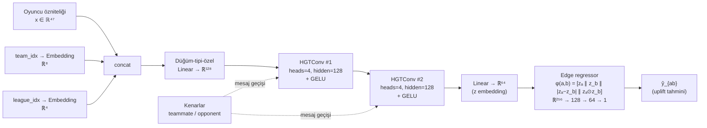

# SynergyHGT — Model Dokümantasyonu

> **Bu dosya "model durum sertifikası"dır.** Modelde değişiklik / ekleme / faz ilerlemesi olduğunda buraya yansıt. Her bölüm güncel haliyle tutulur; geçmiş "Değişiklik Günlüğü" bölümünde kalır.

**Son güncelleme:** 2026-05-21
**Sezon:** 2025-2026
**Versiyon:** Faz 1.4 (+ Takım/Lig embedding)

---

## Soyut

oyuncu-bazlı maç verisinden inşa edilen heterojen graf üzerinde **SynergyHGT** adlı modeli sunuyoruz. Model, oyuncu çiftlerinin birlikte oynadıkları sürede ürettikleri ortak çıktının, bireysel beklentilerinin **üzerine çıkış miktarını** (uplift) regrese eder. Hedef: kadro tamamlama ve benzer-oyuncu çıkarımı için bir sinerji embedding uzayı öğrenmek.

---

## 1. Veri ve Graf İnşası

**Kaynak.** `player_stats` (maç başı 77 kolon stat), `matches` (metadata), `player_avg_positions` (maç başına oyuncu X/Y koordinat ortalaması). Tek sezon ölçeği: 2025-2026, 7 lig, ~1970 maç.

**Düğümler.** Tek tip: `player`. n = 3.668. Öznitelik vektörü d = 47:

| Bileşen | Boyut | Açıklama |
|---|---|---|
| Per-90 stats | 31 | G, A, xG, xA, npxG, progressive carries/passes, tackles, interceptions, passes_pct, take_ons, aerials, fouls, kartlar … (z-skor normalize) |
| Fiziki | 2 | yaş, boy (z-skor) |
| Ayak | 3 | one-hot (left / right / both) |
| Pozisyon | 11 | 11-sınıf koordinat-tabanlı (GK, RB, RCB, LCB, LB, RWB, LWB, CDM, CM, CAM, RW, LW, ST) — [`positions.py`](src/graph/positions.py) |

**Kenarlar.**
- `('player', 'teammate', 'player')` — aynı takımda aynı anda sahada olunan kümülatif dakika ≥ 90. m = 31.323.
- `('player', 'opponent', 'player')` — mesaj geçişinde, loss'a dahil değil. m = 102.142.

Her kenar iki yön olarak depolanır (yönsüz simulasyon).

**Hedef değişken — uplift formülasyonu:**

$$
y_{ab} = \text{per90}_{\text{pair}}(a,b) \;-\; \big(\text{solo per90}(a) + \text{solo per90}(b)\big)
$$

- $\text{solo per90}(p)$ — oyuncu $p$'nin tüm sezon ağırlıklı bireysel (G+A)/90 baseline'ı.
- $\text{per90}_{\text{pair}}(a,b)$ — $a$ ve $b$'nin sahada birlikte oldukları her dakikadaki ortak (G+A)/90.

Pozitif $y$ = sinerji ("birlikteyken beklenenin üstüne çıkıyorlar"); negatif = anti-sinerji.

**İstatistikler:** μ = 0.176, σ = 0.437, aralık [-1.48, +7.43].


---

## 2. Mimari — SynergyHGT



### Enkoder

- **Kategorik embedding'ler (Faz 1.4):** Oyuncu özniteliği ile concat edilen iki öğrenilebilir embedding:
  - `team_emb` — $\mathbb{R}^{135 \times 8}$ (sezonda 135 takım)
  - `league_emb` — $\mathbb{R}^{7 \times 4}$ (7 lig)
  - Bias-ayrıştırma kanalı: "aynı takım / aynı lig" sinyalini ayrı kanalda öğrenir → sinerji embedding'i bundan arınır.
- **Düğüm-tipi-özel giriş projeksiyonu:** $h^{(0)}_i = W_{\tau(i)} [x_i \,\Vert\, e^{\text{team}}_i \,\Vert\, e^{\text{lig}}_i]$, çıktı $\mathbb{R}^{128}$.
- **2 katman HGTConv** (Hu et al., *WWW 2020*) — PyG `HGTConv`. Her katmanda:
  - Head sayısı $H = 4$, gizli boyut 128.
  - Her kenar-tipi için ayrı $K_\tau, Q_\tau, V_\tau$ projeksiyonları.
  - Düğüm-tipi-özel skala $\mu_\tau$ + attention head'leri (relation-aware).
- **Çıkış projeksiyonu:** $z_i = W_{\text{out}} h^{(2)}_i$, $z_i \in \mathbb{R}^{64}$.
- **Aktivasyon:** GELU.

### Edge regressor

Distributional semantics (NLI / sentence-pair) literatüründen esinli 4-yollu özellik:

$$
\phi(a,b) = [\, z_a \;\Vert\; z_b \;\Vert\; |z_a - z_b| \;\Vert\; z_a \odot z_b \,] \in \mathbb{R}^{256}
$$

- L1 fark $|z_a - z_b|$ → "ne kadar uzaklar"
- Hadamard çarpım $z_a \odot z_b$ → "ortak yönleri"

İki katmanlı MLP: $256 \to 128 \to 64 \to 1$, GELU + Dropout 0.2. Çıktı $\hat{y}_{ab} \in \mathbb{R}$.

---

## 3. Eğitim Protokolü

**Edge split — Player-disjoint** (Faz 1.1). Oyuncu kümesi 70/15/15:
- $a, b \in \mathcal{P}_{\text{train}}$ ⇒ train
- en az biri $\mathcal{P}_{\text{test}}$ ⇒ test
- aksi ⇒ val (inductive: en az biri $\mathcal{P}_{\text{val}}$)

Test oyuncuları mesaj geçişinden komple izole edilir → ezber imkansız.

**Mesaj geçişi maskelemesi.** Her epoch yalnız train kenarları üzerinden $z_i$ üretilir (data leakage önlemi).

**Cold-start eval** (Faz 1.3). Test kenarları içinde her iki ucu da hiç eğitimde görülmemiş olanlar ayrı raporlanır (gerçek "yeni transfer" senaryosu).

**Loss:** MSE — $\mathcal{L} = \frac{1}{|E_{\text{train}}|} \sum (y - \hat{y})^2$.

**Optimizasyon:** AdamW, lr = $10^{-3}$, weight_decay = $10^{-4}$. Early stopping val_mse'ye göre, patience = 15.

**Reproducibility:** `torch.manual_seed(42)` + `np.random.seed(42)`.

**Edge dropout:** Default 0.0. (0.15 denendi, bu seyrek grafta zararlı.)

---

## 4. Sonuçlar


| Konfig | Hedef | Split | Test ρ | Test MSE | Yorum |
|---|---|---|---:|---:|---|
| Baseline | joint | random | 0.789 | 0.155 | Şişkin (leakage + yıldız bias) |
| Faz 1.1 | joint | player-disjoint | 0.736 | 0.190 | Gerçek genelleme — leakage küçük |
| Faz 1.2 | **uplift** | player-disjoint | 0.334 | 0.166 | Saf sinerji sinyali |
| Faz 1.3 | uplift | player-disjoint + cold-start eval | 0.325 | 0.172 | Cold-start ölçüldü |
| Faz 1.5 | uplift | + ranking loss λ=1.0, weighted | 0.334 | 0.211 | Sıralamayı doğrudan optimize |
| Faz 1.7 | uplift | **+ λ=0.5 (ablasyon tekrarı)** | **0.371** | **0.167** | cold-start ρ 0.410 — final |
| Faz 1.6 | uplift | + team NULL onarımı | 0.368 | 0.169 | Graf 3495→4962 node; cold-start 0.315→0.389 |
| Faz 1.4 | uplift | + team/league embedding | 0.312 | 0.173 | Bias-ayrıştırma kanalı, cold-start hafif kazanç |

**Cold-start (Faz 1.4):** n = 2.075 kenar, ρ = **0.335** (Faz 1.3'te 0.333). Genel test ρ'su ile neredeyse eşit → model embedding'i ağırlıklı olarak **node feature + team/league emb**'den öğreniyor; mesaj geçişi inceltici katkı.

**Faz 1.4 yorumu.** Genel test ρ marjinal düştü (0.325 → 0.312), cold-start hafif arttı. Uplift hedefi zaten yıldız-bias'ından arındırılmış olduğu için ek bias-ayrıştırma kanalı belirgin etki yapmadı. Embedding'ler default'ta açık kalır — cold-start kazancı ve mimari temizliği nedeniyle.


**Yorum.** Faz 1.2'deki büyük ρ düşüşü model regresyonu değil — trivial "iki oyuncunun solo kalitesinin toplamı" sinyali çıkarıldığında kalan **görev-uygun sinerji sinyali**ni ölçüyor. Eski 0.74 büyük ölçüde "ünlü oyuncu varsa joint G+A yüksek" baseline'ıydı.

---

## 5. Çıkarım Görevleri

| Görev | Modül | Yöntem |
|---|---|---|
| Benzer oyuncu (scouting) | [`similar.py`](src/graph/similar.py) | $\cos(z_a, z_b)$ |
| Kadro tamamlama | [`recommend.py`](src/graph/recommend.py) | Boş slot için, doldurulmuş slot'larla toplam $\hat{y}$'yi maksimize eden top-K aday |
| Takım pozisyon haritası | [`api/gnn_routes.py`](src/api/gnn_routes.py) | `player_avg_positions` X/Y |

---

## 6. Modül Haritası

| Modül | Görev |
|---|---|
| [`edge_builder.py`](src/graph/edge_builder.py) | Lineup overlap + solo baseline + uplift hesabı |
| [`build.py`](src/graph/build.py) | HeteroData inşası, node feature normalize |
| [`positions.py`](src/graph/positions.py) | 11-sınıf koordinat-tabanlı pozisyon çözümü |
| [`model.py`](src/graph/model.py) | SynergyHGT (HGTConv ×2 + 4-yollu edge MLP) |
| [`train.py`](src/graph/train.py) | Player-disjoint split, MSE eğitim, Spearman + cold-start eval |
| [`recommend.py`](src/graph/recommend.py) | Kadro tamamlama inference |
| [`similar.py`](src/graph/similar.py) | Cosine-similarity scouting |
| [`api/gnn_routes.py`](src/api/gnn_routes.py) | FastAPI endpoint'leri |

---

## 7. Çalıştırma

```bash
# 1. Edge'ler (lineup overlap + uplift)
python -m src.graph.edge_builder --season 2025-2026

# 2. Graph (uplift hedefli)
python -m src.graph.build --season 2025-2026 --target uplift

# 3. Train (player-disjoint default)
python -m src.graph.train --season 2025-2026 --epochs 100

# 4. Figür yenile (bu dosyadakileri günceller)
python docs/gen_model_figs.py
```

Argüman seçenekleri:
- `--target uplift|joint` ([`build.py`](src/graph/build.py))
- `--split player-disjoint|random` ([`train.py`](src/graph/train.py))
- `--edge-dropout <float>` (default 0.0)

---

## 8. Açık İşler (Sıradaki Fazlar)

- **Faz 2** — UI: mplsoccer pitch → SVG/Canvas web, 11-pozisyon prod'a yayma, squad-completion UX, scouting view ile filtreler.
- Çok-sezonlu graf: `season` embedding ile birden fazla yıl concat.
- xG/xA-bazlı uplift (gerçek G/A daha gürültülü; xG+xA daha kararlı sinyal verebilir).
- Leave-one-out solo baseline (mevcut pragmatik kabulleniş yerine pair-maçları hariç tutan baseline).

---

## 9. Değişiklik Günlüğü

### 2026-05-21 — Faz 1.4: Takım/Lig öğrenilebilir embedding

- `build.py`: oyuncu node'una `team_idx`, `league_idx`, `num_teams`, `num_leagues` eklendi.
- `model.py`: `nn.Embedding(num_teams, 8)` + `nn.Embedding(num_leagues, 4)` — giriş projeksiyonundan önce concat.
- `train.py`: graph'tan num_teams/num_leagues okunup model'e geçirilir.
- Bulgu: Test ρ 0.325 → 0.312 (marjinal düşüş); cold-start ρ 0.333 → 0.335. Uplift hedefi zaten arındırılmış olduğu için ek bias kanalı az etkili. Default'ta açık.

### 2026-05-21 — Faz 1.3: Cold-start eval + Edge dropout deneyi

- `train.py`: `_cold_start_mask()` eklendi; test kenarları içinde her iki ucu da train'de görülmemiş olanlar ayrı raporlanıyor.
- `_build_message_passing_data()` — `edge_dropout` parametresi (default 0.0).
- `torch.manual_seed(42)` + `np.random.seed(42)` → reproducibility.
- Bulgu: Cold-start ρ (0.333) ≈ genel ρ (0.325). Edge dropout 0.15 bu seyrek grafta zararlı → 0.0 default.

### 2026-09-13 — Faz 1.7: ablasyon tekrarı, λ=1.0 → 0.5

- Faz 1.6 grafı değiştirdiği için eski λ sweep'i geçersizdi; 10 konfig tekrarlandı.
- **λ=0.5 + weighted seçildi**: cold-start ρ **0.410** (λ=1.0'da 0.389), test MSE
  **0.167**, test ρ 0.371. Detay tablo: `docs/EXPERIMENT_LOG.md`.
- λ≥2 test ρ'yu yükseltiyor (λ=4'te 0.388) ama MSE'yi bozuyor ve cold-start'a
  katkı vermiyor → reddedildi.
- Konfig seçimi test ρ'ya göre YAPILMADI (10 aday arasından test'e göre seçmek
  test setini validation'a çevirir); val_mse + cold-start üzerinden gerekçelendirildi.

### 2026-09-12 — Faz 1.6: team NULL onarımı (veri hatası)

- `parse_player_stats` takımı `lineups[side]["team"]`'den okuyordu; API o bloğu
  göndermiyor. Doğrusu: oyuncu kaydındaki `teamId` + event'ten isim çözümü.
- 953 maçta (38.849 satır) `team_id`/`team_name` NULL kalmıştı. DB onarıldı.
- Etki: `build.py` son-takım filtresi NULL takımlı oyuncuyu graftan siliyordu.
  **Node 3495 → 4962 (+42%)**, teammate 37.7k → 43.3k, opponent 117k → 151k.
- Test ρ 0.334 → **0.368**, MSE 0.211 → **0.169**, cold-start ρ 0.315 → **0.389** (n=2767).
- Not: eklenen 1467 oyuncu rastgele değil — ağırlıklı olarak Ligue 2 / Primeira /
  Eredivisie. Graf hem büyüdü hem zorlaştı, buna rağmen üç metrik de iyileşti.
  Önceki tüm faz sonuçları eksik graf üzerindeydi.

### 2026-05-21 — Faz 1.2: Uplift hedef değişkeni

- `edge_builder.py`: `_solo_baseline()` + `per90_uplift` kolonu eklendi.
- `build.py`: `--target uplift|joint` flag'i, label seçimi.
- Test ρ 0.736 → 0.334: trivial yıldız-bias sinyali çıkarıldı, saf sinerji sinyali kaldı.

### 2026-05-21 — Faz 1.1: Player-disjoint split

- `train.py`: `_split_edges_player_disjoint()` eklendi. Default split bu.
- Test ρ 0.789 → 0.736: leakage etkisi küçük; model gerçek genelleme yapıyor.

### Önceki — Baseline

- HGT ×2 + 4-yollu edge MLP, random edge split, `per90_joint_output` hedef.
- Test ρ ≈ 0.79 (sonradan şişkin olduğu anlaşıldı).
