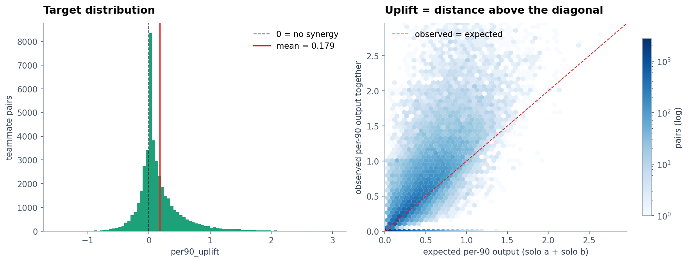
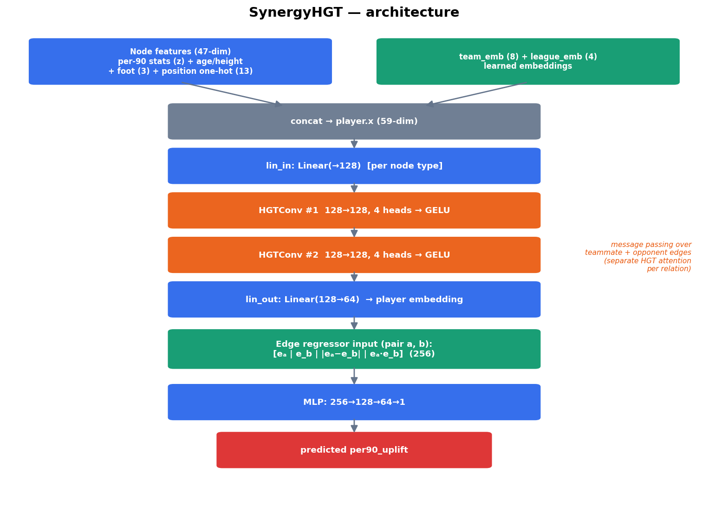
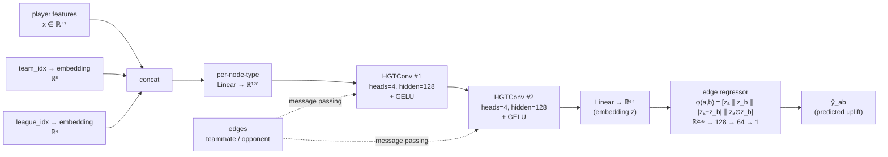
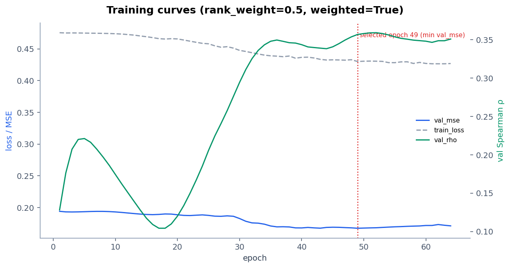
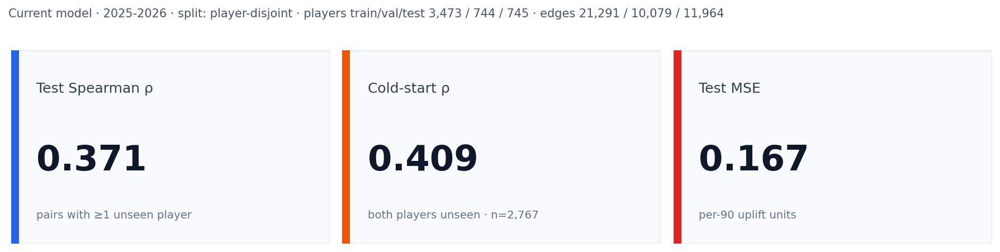
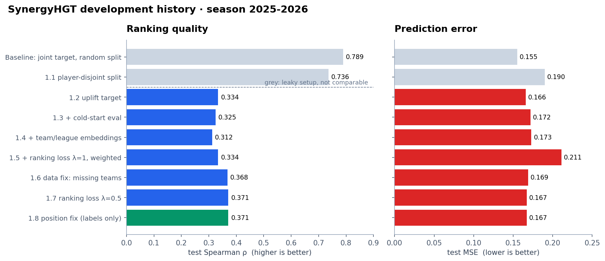
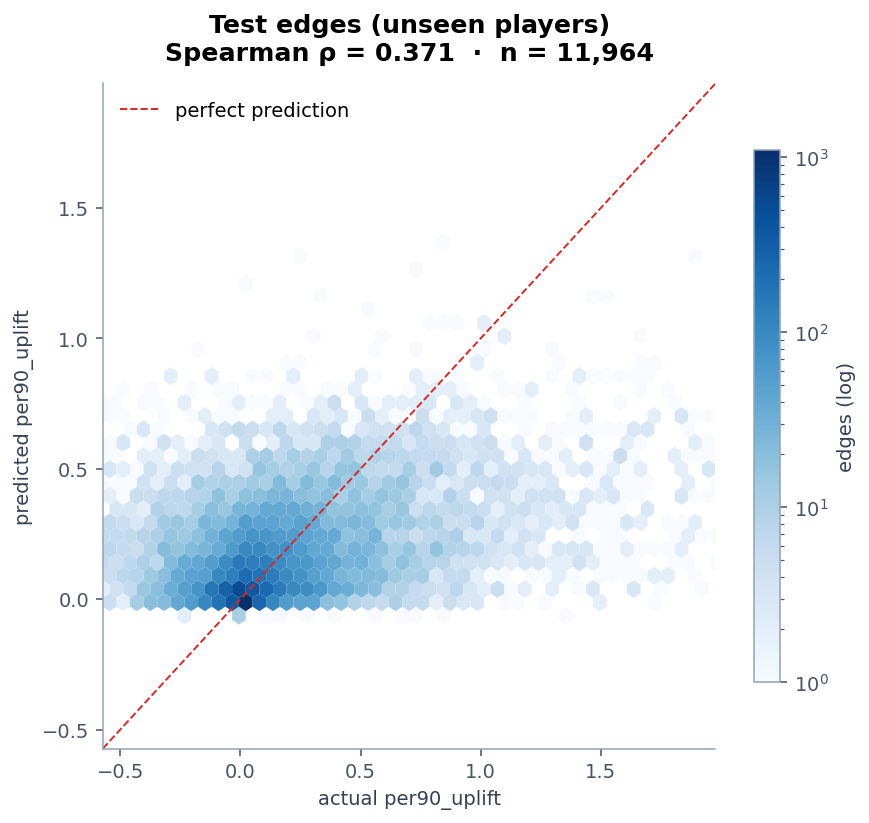
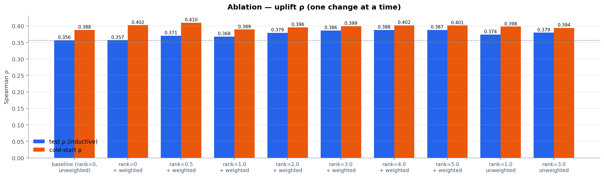

# SynergyHGT — model documentation

> Living document: update it whenever the model, data or evaluation changes. History lives in
> the changelog at the end.

**Last updated:** 2026-11-16 · **Season:** 2025-2026 · **Version:** phase 1.8 (position fix)

---

## Abstract

SynergyHGT is a heterogeneous graph transformer trained on match-level player data. For every
pair of teammates it regresses the **uplift**: how much more (or less) the pair produces per 90
minutes together than their individual baselines predict. The goal is a synergy embedding space
for squad completion and similar-player search.

---

## 1. Data and graph

**Sources.** Per-match player statistics (`player_stats`), match metadata (`matches`) and
per-match average player positions (`player_avg_positions`). One season (2025-2026),
9 leagues.

**Nodes.** One type, `player`, n = 4,962. Feature vector d = 47:

| Block | Dims | Description |
|---|---:|---|
| Per-90 stats | 29 | goals, assists, xG, xA, npxG, progressive carries/passes, shots, tackles, interceptions, blocks, clearances, pass completion, final-third and box entries, touches, take-ons, aerials, fouls, cards … (z-scored) |
| Physical | 2 | age, height (z-scored) |
| Foot | 3 | one-hot (left / right / both) |
| Position | 13 | one-hot over the position taxonomy; the coordinate rule produces 11 of them (GK, RB, RCB, LCB, LB, CDM, CM, CAM, RW, LW, ST) — [`positions.py`](src/graph/positions.py) |

Missing stats are imputed with the league × position median.

**Edges.**
- `('player', 'teammate', 'player')` — pairs who shared the pitch for the same team; labelled. m = 43.3k.
- `('player', 'opponent', 'player')` — used for message passing only, never in the loss. m = 151k.

Each edge is stored in both directions.

**Target — uplift:**

$$
y_{ab} = \text{per90}_{\text{pair}}(a,b) \;-\; \big(\text{solo per90}(a) + \text{solo per90}(b)\big)
$$

- $\text{solo per90}(p)$ — player $p$'s season (G+A)/90 baseline.
- $\text{per90}_{\text{pair}}(a,b)$ — joint (G+A)/90 during the minutes $a$ and $b$ were on the pitch together.

Positive $y$ = synergy, negative = anti-synergy. Statistics: μ = 0.179, σ = 0.447, range [−1.49, +7.50].



---

## 2. Architecture





### Encoder

- **Categorical embeddings:** learned `team_emb` ($\mathbb{R}^{178 \times 8}$) and `league_emb`
  ($\mathbb{R}^{9 \times 4}$), concatenated with the player features. They give "same team /
  same league" effects their own channel so the synergy embedding does not have to absorb them.
- **Input projection** per node type: $h^{(0)}_i = W_{\tau(i)} [x_i \,\Vert\, e^{\text{team}}_i \,\Vert\, e^{\text{league}}_i] \in \mathbb{R}^{128}$.
- **2 × HGTConv** (Hu et al., WWW 2020; PyG `HGTConv`), 4 heads, hidden 128, separate
  $K_\tau, Q_\tau, V_\tau$ projections per relation.
- **Output projection:** $z_i = W_{\text{out}} h^{(2)}_i \in \mathbb{R}^{64}$. Activation: GELU.

### Edge regressor

The four-way pair representation from sentence-pair models:

$$
\phi(a,b) = [\, z_a \;\Vert\; z_b \;\Vert\; |z_a - z_b| \;\Vert\; z_a \odot z_b \,] \in \mathbb{R}^{256}
$$

$|z_a - z_b|$ captures how different the players are, $z_a \odot z_b$ what they share.
MLP $256 \to 128 \to 64 \to 1$ with GELU and dropout 0.2.

---

## 3. Training protocol

**Player-disjoint split.** Players are split 70 / 15 / 15:
- both players in $\mathcal{P}_{\text{train}}$ → train edge
- at least one player in $\mathcal{P}_{\text{test}}$ → test edge
- otherwise, at least one in $\mathcal{P}_{\text{val}}$ → validation edge

**Message-passing mask.** Embeddings are computed from training teammate edges only; validation
and test teammate edges (and their labels) never enter the encoder. Test players still receive
messages through unlabelled opponent edges and their own features.

**Cold-start evaluation.** Test edges whose two players both have no training teammate edge are
reported separately — the "new signing next to a new signing" case.

**Loss.**

$$
\mathcal{L} = \frac{\sum_e w_e (y_e - \hat{y}_e)^2}{\sum_e w_e} \;+\; \lambda \cdot \mathcal{L}_{\text{rank}}, \qquad w_e = \sqrt{\text{minutes together}_e}, \;\; \lambda = 0.5
$$

$\mathcal{L}_{\text{rank}}$ is a pairwise logistic loss on randomly sampled edge pairs,
$\text{softplus}(-\text{sign}(y_i - y_j)(\hat{y}_i - \hat{y}_j))$ — a differentiable surrogate for Spearman ρ.

**Optimisation.** AdamW, lr $10^{-3}$, weight decay $10^{-4}$, up to 100 epochs, early stopping
on validation MSE (patience 15). The checkpoint with minimum validation MSE is kept; selecting
on validation ρ overfits. Seeds fixed (`torch.manual_seed(42)`, `np.random.seed(42)`).

**Edge dropout:** 0.0 (0.15 was tried and hurts on this sparse graph).



---

## 4. Results





| Phase | Target | Change | Test ρ | Test MSE | Note |
|---|---|---|---:|---:|---|
| Baseline | joint | random edge split | 0.789 | 0.155 | inflated (leakage + star effect) |
| 1.1 | joint | player-disjoint split | 0.736 | 0.190 | real generalisation, small leakage |
| 1.2 | **uplift** | uplift target | 0.334 | 0.166 | pure synergy signal |
| 1.3 | uplift | + cold-start evaluation | 0.325 | 0.172 | cold-start measured |
| 1.4 | uplift | + team/league embeddings | 0.312 | 0.173 | small cold-start gain |
| 1.5 | uplift | + ranking loss λ=1.0, weighted | 0.334 | 0.211 | optimises ranking directly |
| 1.6 | uplift | data fix: missing team ids | 0.368 | 0.169 | graph 3,495 → 4,962 players |
| 1.7 | uplift | λ = 0.5 (ablation re-run) | 0.371 | 0.167 | cold-start ρ 0.410 |
| **1.8** | uplift | position fix for high-line centre-backs | **0.371** | **0.167** | cold-start ρ **0.409**; labels corrected, metrics unchanged |

**Reading the drop at phase 1.2.** It is not a regression. Once the trivial "sum of the two
players' solo quality" signal is removed, what remains is the synergy signal the task is
actually about. The old 0.74 was mostly "if a star is involved, joint output is high".

**Cold-start ≥ test ρ.** Cold-start ρ (0.409, n = 2,767) is slightly higher than overall test ρ.
The embedding is learned mostly from node features and team/league embeddings; message
passing refines it. That is what makes the model usable for players it has never seen.





---

## 5. Inference tasks

| Task | Module | Method |
|---|---|---|
| Similar players | [`similar.py`](src/graph/similar.py) | cosine similarity of $z$ |
| Squad completion | [`recommend.py`](src/graph/recommend.py) | for an empty slot, top-K candidates maximising summed $\hat{y}$ with the filled slots |
| Team position map | [`api/gnn_routes.py`](src/api/gnn_routes.py) | season-average X/Y from `player_avg_positions` |

---

## 6. Module map

| Module | Role |
|---|---|
| [`edge_builder.py`](src/graph/edge_builder.py) | shared minutes, solo baselines, uplift |
| [`build.py`](src/graph/build.py) | HeteroData construction, feature normalisation |
| [`positions.py`](src/graph/positions.py) | base-code + coordinate position rule |
| [`model.py`](src/graph/model.py) | SynergyHGT (2 × HGTConv + four-way edge MLP) |
| [`train.py`](src/graph/train.py) | player-disjoint split, training, Spearman + cold-start evaluation |
| [`recommend.py`](src/graph/recommend.py) | squad-completion inference |
| [`similar.py`](src/graph/similar.py) | similarity search |
| [`api/gnn_routes.py`](src/api/gnn_routes.py) | FastAPI endpoints |

---

## 7. Running

```bash
python -m src.graph.edge_builder --season 2025-2026
python -m src.graph.build --season 2025-2026 --target uplift
python -m src.graph.train --season 2025-2026 --rank-weight 0.5 --weighted
python -m src.graph.visualize --season 2025-2026   # architecture, pipeline, curves, scatter
python -m docs.gen_model_figs                      # metric figures
```

Options: `--target uplift|joint` (build), `--split player-disjoint|random`,
`--edge-dropout <float>`, `--rank-weight <float>`, `--weighted` (train).

---

## 8. Next steps

- Multi-season graph with a season embedding.
- xG + xA based uplift (goals and assists are noisier).
- Leave-one-out solo baseline that excludes the pair's shared minutes.
- Single-variable sweeps: weight decay, embedding size, 1 vs 3 HGT layers.

---

## 9. Changelog

### 2026-11-16 — phase 1.8: centre-backs in high lines

- Defenders with a season-average X of 38–43 and Y of 28–72 are now centre-backs. Before, the
  rule only treated X < 38 as "deep", so centre-backs of high-line teams (Saliba, Guéhi,
  Schlotterbeck, Huijsen …) fell into the full-back branch. 77 defenders relabelled; true
  full-backs at that depth sit at Y < 28 or Y > 72 and are unaffected.
- Graph rebuilt and model retrained: test ρ 0.3705 → 0.3705, cold-start ρ 0.4097 → 0.4093,
  MSE 0.1671 → 0.1671. Labels and squad suggestions are correct now; metrics unchanged.
- API: season-average positions, minutes and the `min_minutes` filter now only use matches of
  the model's season (they summed every season in the database).

### 2026-09-13 — phase 1.7: ablation re-run, λ = 1.0 → 0.5

- Phase 1.6 changed the graph, so the λ sweep was repeated (10 configurations).
- **λ = 0.5 + weighted**: cold-start ρ **0.410** (0.389 at λ = 1.0), test MSE **0.167**, test ρ 0.371.
- λ ≥ 2 raises test ρ (0.388 at λ = 4) but degrades MSE and does not help cold-start → rejected.
- The configuration was not picked on test ρ; picking the best of ten on the test set would turn
  it into a validation set.

### 2026-09-12 — phase 1.6: missing team ids (data bug)

- The parser read the team from a field that does not exist at that level of the lineup
  response; the correct source is each player's own team id. 38,849 rows in 953 matches had no
  team and were repaired.
- Effect: the "last team of the season" filter in `build.py` dropped every player without a
  team. **Players 3,495 → 4,962 (+42 %)**, teammate edges 37.7k → 43.3k, opponent 117k → 151k.
- Test ρ 0.334 → **0.368**, MSE 0.211 → **0.169**, cold-start ρ 0.315 → **0.389**. The added
  players are mostly from smaller leagues, so the graph got larger and harder, and all three
  metrics still improved.

### 2026-05-21 — phase 1.4: team / league embeddings

- `team_idx` and `league_idx` on player nodes; `nn.Embedding(num_teams, 8)` and
  `nn.Embedding(num_leagues, 4)` concatenated before the input projection.
- Test ρ 0.325 → 0.312, cold-start ρ 0.333 → 0.335. Kept on for the cold-start gain.

### 2026-05-21 — phase 1.3: cold-start evaluation, edge dropout

- `_cold_start_mask()` reports test edges whose players are both unseen.
- `edge_dropout` parameter; 0.15 hurts on this graph → default 0.0. Seeds fixed.

### 2026-05-21 — phase 1.2: uplift target

- `_solo_baseline()` and `per90_uplift` in `edge_builder.py`; `--target uplift|joint` in `build.py`.
- Test ρ 0.736 → 0.334: the star signal is removed, the synergy signal remains.

### 2026-05-21 — phase 1.1: player-disjoint split

- `_split_edges_player_disjoint()`, now the default. Test ρ 0.789 → 0.736.

### Baseline

- 2 × HGT + four-way edge MLP, random edge split, `per90_joint_output` target. Test ρ ≈ 0.79 (later shown to be inflated).
