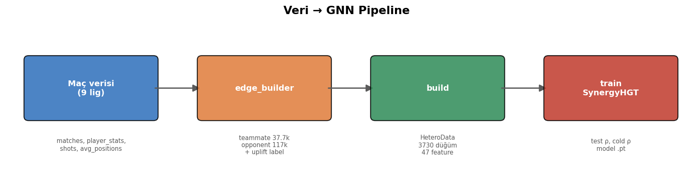

# Football Synergy GNN

Hangi oyuncular **birlikte** sahadayken bireysel kalitelerinin toplamından daha fazlasını üretiyor?

Bu proje, maç bazlı oyuncu verisinden heterojen bir oyuncu grafı kurar ve **SynergyHGT** adlı bir
Graph Neural Network ile oyuncu çiftlerinin sinerjisini tahmin eder. Öğrenilen oyuncu
embedding'leri üç işte kullanılır:

- **Sinerji skoru**: iki oyuncu birlikte oynadığında beklenenin ne kadar üstüne çıkıyor
- **Kadro tamamlama**: mevcut 10 oyuncuya en iyi uyan 11. oyuncu (pozisyon kısıtlı)
- **Benzer oyuncu**: transfer scouting için embedding uzayında en yakın oyuncular



## Neden "uplift"?

Ham ortak çıktıyı (iki oyuncunun birlikteyken ürettiği G+A vb.) hedef almak, modeli yıldız
oyuncuları ezberlemeye iter: iyi iki oyuncu birlikte de iyidir, bu sinerji değildir.
Bu yüzden hedef saf sinerjidir:

```
per90_uplift = gözlenen_çift_per90 − (solo_a_per90 + solo_b_per90)
```

Değerlendirme de bilerek zorlaştırıldı: **player-disjoint split** kullanılıyor, yani test
oyuncuları eğitimde ve mesaj geçişinde hiç görülmüyor (inductive). Kolay kurulumla (ham hedef +
random split) ρ≈0.79 elde ediliyordu; bu sayı leakage ve yıldız etkisiyle şişkindi.

## Model


| Bileşen | Detay |
|---|---|
| Graf | Düğüm: oyuncu. Kenar: `teammate` (etiketli) + `opponent` (yalnız bağlam) |
| Düğüm özniteliği | 47-dim: per-90 istatistik z-skorları, yaş/boy, ayak, 11 detaylı pozisyon one-hot |
| Ek embedding | Öğrenilebilir takım (8-dim) + lig (4-dim) |
| Enkoder | 2× HGTConv, 4 head, hidden 128 → 64-dim oyuncu embedding |
| Kenar regresörü | MLP: `[e_a, e_b, \|e_a − e_b\|, e_a ⊙ e_b]` |
| Kayıp | Dakika-ağırlıklı MSE + 0.5 × sıralama kaybı (Spearman surrogate) |
| Model seçimi | `val_mse` (val ρ ile seçim overfit ediyor) |

### Pozisyon türetimi

Ham veride yalnızca G/D/M/F var. Bu kod ana sınıfı belirler; maç başı ortalama X/Y koordinatı
**sadece** alt pozisyon ayrımında kullanılır (RB/LB/RCB/LCB, CDM/CM/CAM, RW/LW/ST). Böylece
derinde oynayan bir orta saha koordinatı yüzünden stopere düşmez.
Bkz. [`src/graph/positions.py`](src/graph/positions.py).

## Sonuçlar

25/26 sezonu, 9 Avrupa ligi: 4.962 oyuncu, 43,3k teammate ve 151k opponent kenarı.

| Metrik | Değer |
|---|---:|
| Test Spearman ρ | **0.371** |
| Cold-start ρ (hiç görülmemiş oyuncu çiftleri) | **0.410** |
| Test MSE | **0.167** |


Tek değişkenli ablasyonların tamamı [`docs/EXPERIMENT_LOG.md`](docs/EXPERIMENT_LOG.md) içinde,
teknik rapor [`MODEL.md`](MODEL.md) içinde.

## Repo yapısı

```
src/graph/      edge_builder → build → train, model, öneri motoru, benzerlik
src/api/        FastAPI; GNN uç noktaları /gnn/* altında + statik HTML arayüz
src/analysis/   rol profilleri, pozisyon çözümleme, transfer analizi
src/tactical/   stil uyumu, oyuncu değişikliği sıralaması
data/db/        PostgreSQL şeması
docs/           figürler ve deney günlüğü
app.py          Streamlit geliştirme arayüzü
```

## Çalıştırma

> **Veri bu repoda yok.** Ne ham maç verisi ne de eğitilmiş model ağırlıkları dağıtılıyor.
> Kod, aşağıdaki tabloları içeren bir PostgreSQL veritabanı bekler.

| Tablo | İçerik |
|---|---|
| `matches` | Maç metadata (lig, sezon, tarih, takımlar) |
| `player_stats` | Maç başı oyuncu istatistikleri (dakika, pozisyon kodu, rating, şut, pas…) |
| `player_avg_positions` | Maç başı oyuncu ortalama konumu: `match_id`, `source_player_id`, `avg_x`, `avg_y`, `points_count` (0–100 ölçek) |

İlk iki tablonun tam şeması: [`data/db/schema.sql`](data/db/schema.sql).

```bash
pip install -r requirements.txt   # torch / torch-geometric için dosyadaki nota bakın
```

Bağlantı ortam değişkenlerinden okunur: `DB_HOST`, `DB_PORT`, `DB_NAME`, `DB_USER`, `DB_PASSWORD`.

```bash
python -m src.graph.edge_builder --season 2025-2026
python -m src.graph.build --season 2025-2026
python -m src.graph.train --season 2025-2026 --rank-weight 0.5 --weighted
uvicorn src.api.main:app --reload
```

## Lisans

Kod [MIT](LICENSE) lisanslıdır. Veri dahil değildir.
