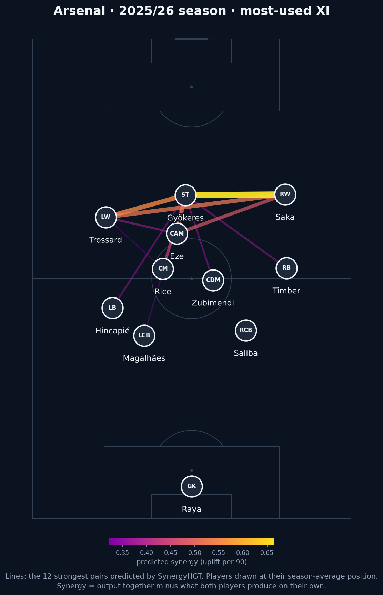
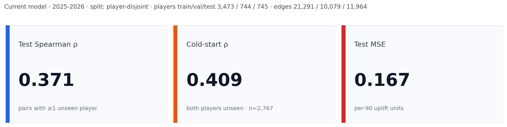
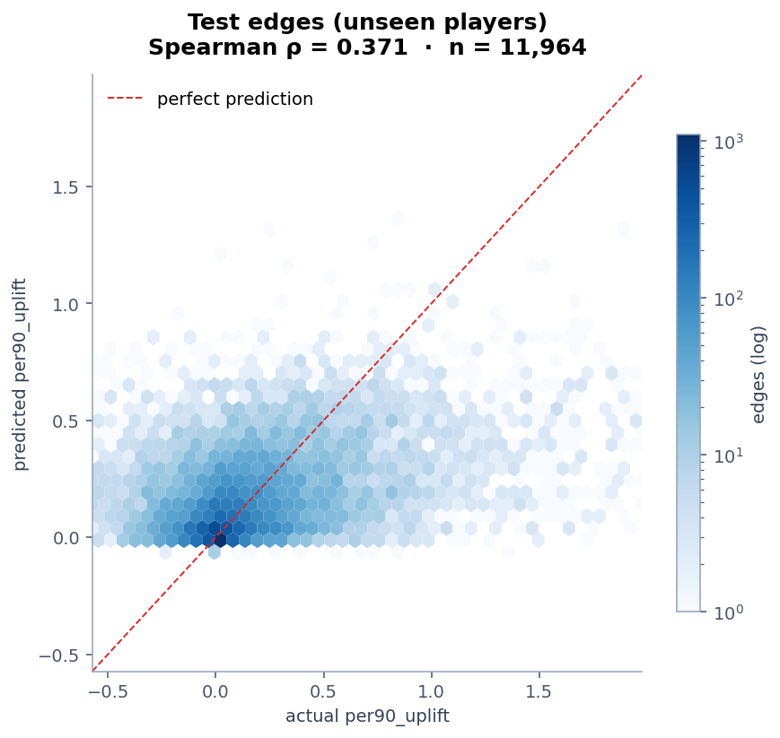

# Football Synergy GNN

**Which players produce more together than the sum of their individual quality?**

This project builds a heterogeneous player graph from match-level data across nine European
leagues and trains **SynergyHGT**, a graph neural network that predicts how well two players
combine. The learned player embeddings power three scouting tasks:

- **Pair synergy** — how far above expectation two players perform when they share the pitch
- **Squad completion** — the best candidates for an empty slot given the other ten players
- **Similar players** — nearest neighbours in embedding space for recruitment shortlists

<p align="center">
  
</p>

## Why "uplift"?

Training on raw joint output (goals + assists two players produce together) teaches a model
to recognise stars: two good players are productive together, but that is not synergy.
The target here is the part that is left over:

```
per90_uplift = observed pair output per 90 − (solo output per 90 of a + of b)
```

Evaluation is deliberately strict. The split is **player-disjoint**: test players' teammate
edges and labels are never used in training, so a test pair always involves at least one
player the model has only seen through their features and unlabelled opponent context. The easy
setup (raw target + random edge split) scored ρ ≈ 0.79; that number was inflated by leakage
and star effects and is not comparable.

## Results

Season 2025/26 · 9 leagues · 4,962 players · 43.3k teammate and 151k opponent edges.



| Metric | Value | What it measures |
|---|---:|---|
| Test Spearman ρ | **0.371** | ranking of pairs with at least one unseen player |
| Cold-start ρ | **0.409** | pairs where **both** players are unseen (a new signing next to a new signing) |
| Test MSE | **0.167** | error in per-90 uplift units |



Every change was tested one variable at a time — see [`docs/EXPERIMENT_LOG.md`](docs/EXPERIMENT_LOG.md).
The full technical write-up is in [`MODEL.md`](MODEL.md).


## Model


| Component | Detail |
|---|---|
| Graph | Node: player. Edges: `teammate` (labelled) + `opponent` (context only) |
| Node features | 47-dim: 29 per-90 stats + age + height (z-scored), preferred foot (3), position one-hot (13) |
| Extra embeddings | Learned team (8-dim) + league (4-dim) |
| Encoder | 2× HGTConv, 4 heads, hidden 128 → 64-dim player embedding |
| Edge regressor | MLP on `[e_a, e_b, \|e_a − e_b\|, e_a ⊙ e_b]` |
| Loss | Minutes-weighted MSE + 0.5 × pairwise ranking loss (Spearman surrogate) |
| Checkpoint selection | Minimum validation MSE (selecting on validation ρ overfits) |

### Positions

The raw data only has a coarse G/D/M/F code. That code decides the class; the player's
season-average X/Y position is used **only** to split it further (RB/RCB/LCB/LB, CDM/CM/CAM,
RW/ST/LW). A deep-lying midfielder therefore stays a midfielder instead of being labelled a
centre-back, and centre-backs in high defensive lines are not mistaken for full-backs.
See [`src/graph/positions.py`](src/graph/positions.py) and its tests.

## Repository layout

```
src/graph/      edge_builder → build → train, model, squad recommender, similarity
src/api/        FastAPI app; GNN endpoints under /gnn/* plus a static HTML front end
src/analysis/   role profiles, position resolution, transfer analysis
src/tactical/   style fit, replacement ranking
data/db/        PostgreSQL schema
docs/           figures, figure scripts and the experiment log
tests/          unit tests
app.py          Streamlit development UI
```

## Running it

> **No data is included.** Neither match data nor trained weights are distributed.
> The code expects a PostgreSQL database with the tables below.

| Table | Content |
|---|---|
| `matches` | match metadata (league, season, date, teams) |
| `player_stats` | per-match player statistics (minutes, position code, passes, shots, …) |
| `player_avg_positions` | per-match average position: `match_id`, `source_player_id`, `avg_x`, `avg_y`, `points_count` (0–100 scale) |

Full schema for the first two: [`data/db/schema.sql`](data/db/schema.sql).

```bash
pip install -r requirements.txt   # see the note in the file for torch / torch-geometric wheels
```

The connection is read from `DB_HOST`, `DB_PORT`, `DB_NAME`, `DB_USER` and `DB_PASSWORD`.

```bash
python -m src.graph.edge_builder --season 2025-2026
python -m src.graph.build --season 2025-2026
python -m src.graph.train --season 2025-2026 --rank-weight 0.5 --weighted
uvicorn src.api.main:app --reload

python -m docs.gen_model_figs     # refresh figures
python -m docs.gen_hero           # hero image (team and season as arguments)
python -m pytest tests
```

## License

The code is [MIT](LICENSE) licensed. No data is included.
