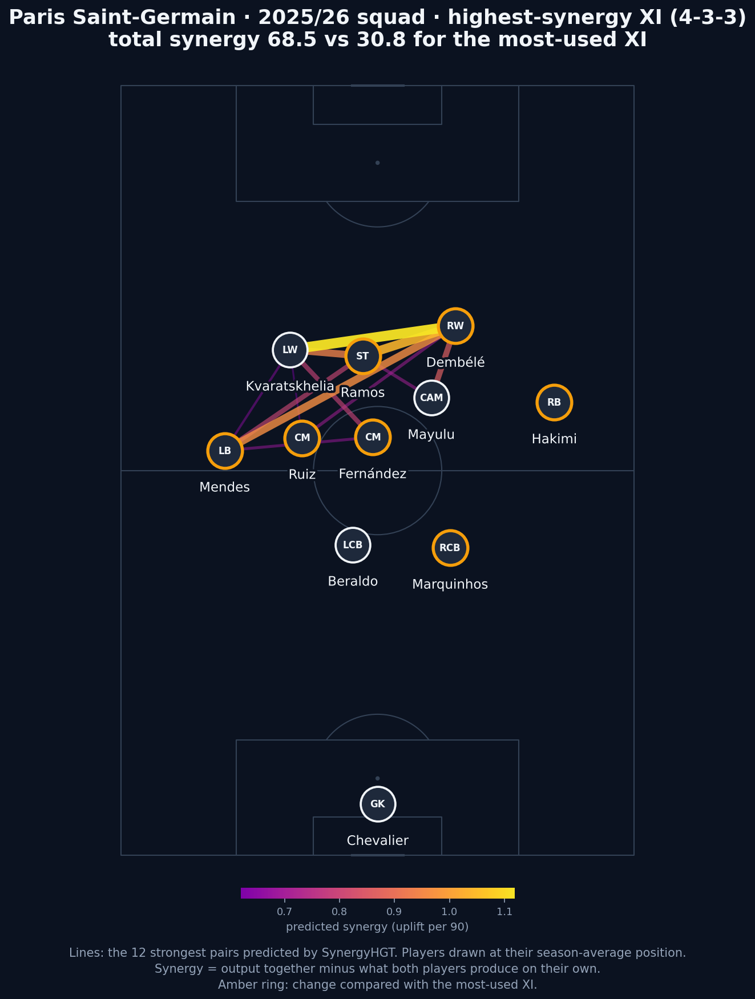
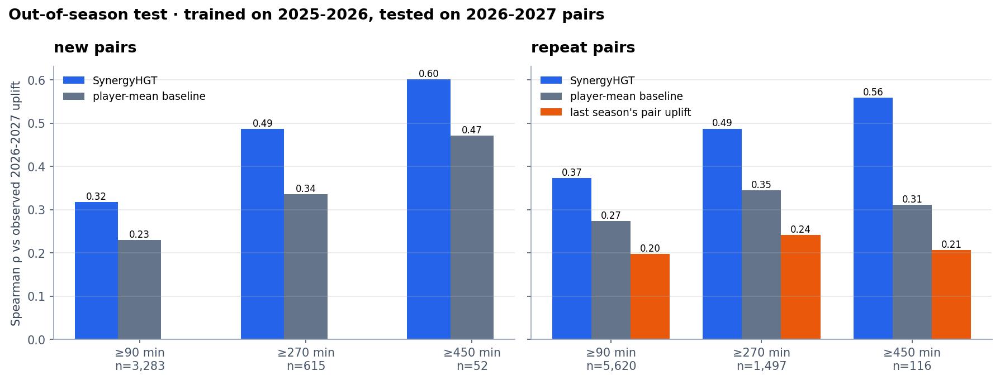
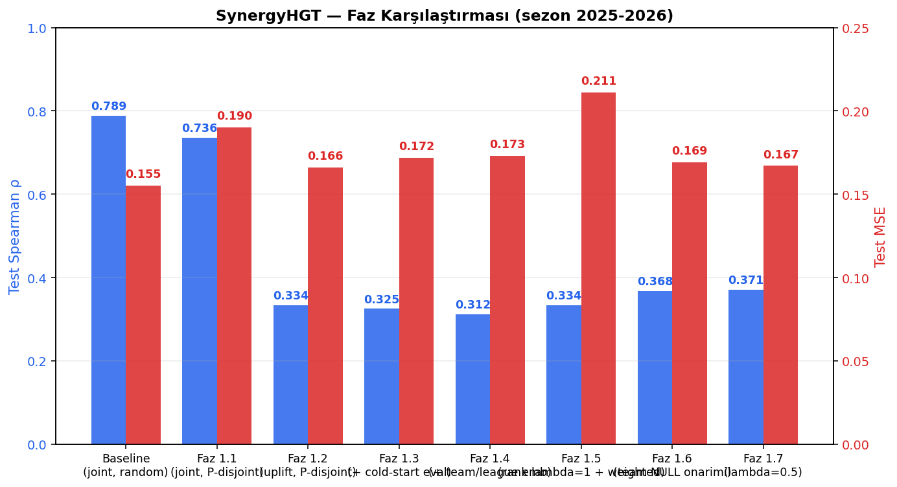
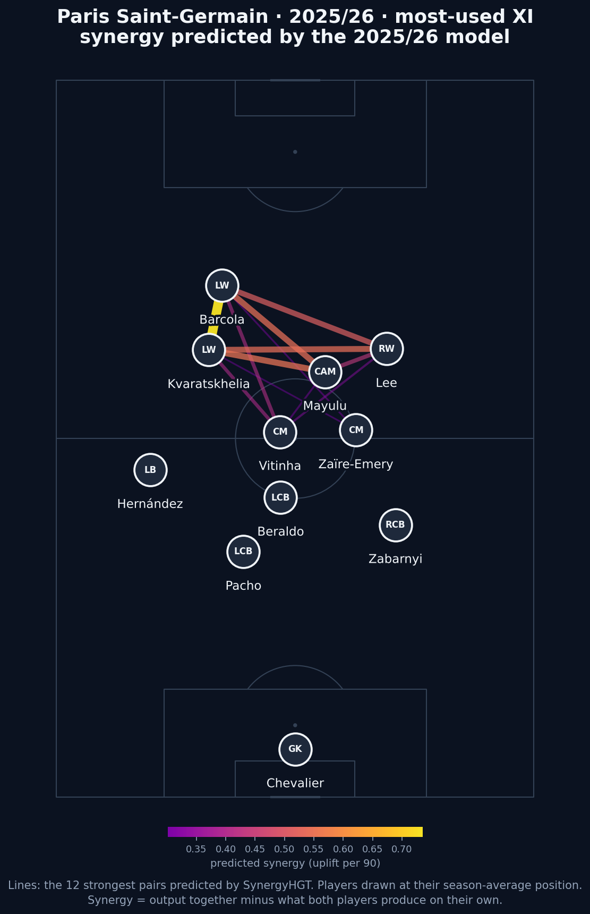
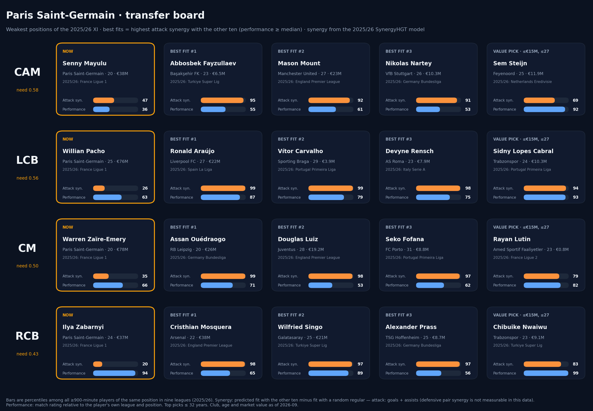
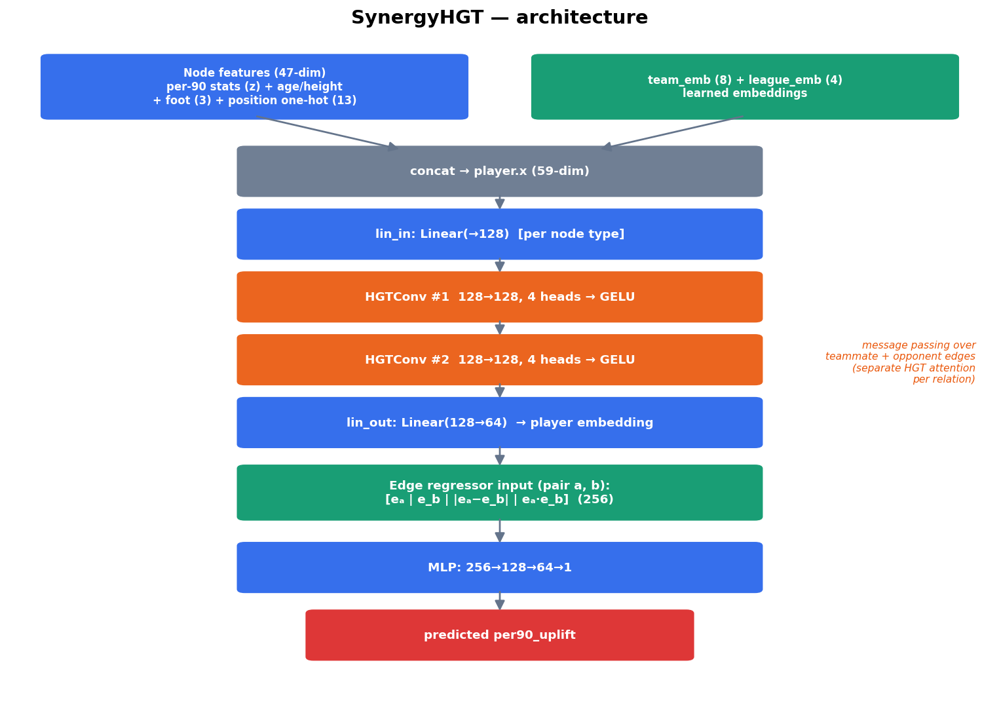

# Football Synergy GNN

**Which players produce more together than the sum of their individual quality?**

This project builds a heterogeneous player graph from match-level data across nine European
leagues and trains **SynergyHGT**, a graph neural network that predicts how well two players
combine. The learned player embeddings power three scouting tasks:

- **Pair synergy** — how far above expectation two players perform when they share the pitch
- **Squad completion** — the best candidates for an empty slot given the other ten players
- **Similar players** — nearest neighbours in embedding space for recruitment shortlists
- **Club report** — weak links of an XI, transfer candidates and the squad's highest-synergy XI

<p align="center">
  
</p>

## Why "uplift"?

Training on raw joint output (goals + assists two players produce together) teaches a model
to recognise stars: two good players are productive together, but that is not synergy.
The target here is the part that is left over:

```
per90_uplift = observed pair output per 90 − (solo output per 90 of a + of b)
```

Evaluation is deliberately strict. The split is **player-disjoint**: test players' teammate
edges and labels are never used in training, so a test pair always involves at least one
player the model has only seen through their features and unlabelled opponent context. The easy
setup (raw target + random edge split) scored ρ ≈ 0.79; that number was inflated by leakage
and star effects and is not comparable.

## Results

Season 2025/26 · 9 leagues · 4,962 players · 43.3k teammate and 151k opponent edges.


| Metric | Value | What it measures |
|---|---:|---|
| Test Spearman ρ | **0.351** (3 seeds: 0.351–0.362) | ranking of pairs with at least one unseen player |
| Cold-start ρ | **0.378** (0.378–0.396) | pairs where **both** players are unseen (a new signing next to a new signing) |
| Test MSE | **0.171** (0.170–0.171) | error in per-90 uplift units |

Results are stable across initialisation seeds. An earlier version reported ρ 0.371; that
came from one lucky seed of a model that collapsed (ρ ≈ 0.1) with two other seeds, because
players with only a few minutes had extreme per-90 features. Those rates are now shrunk
towards their league × position average (see [`MODEL.md`](MODEL.md#1-data-and-graph)).


### Out-of-season test: does it hold up next season?

The model trained on 2025/26 was used, unchanged, to predict the synergy of teammate pairs in
the **2026/27** season and compared with what those pairs actually produced. It is compared
with a non-GNN baseline: the mean 2025/26 uplift of each player's partnerships, summed.



| 2026/27 pairs | Shared minutes | n | SynergyHGT ρ | Player-mean baseline ρ |
|---|---|---:|---:|---:|
| **New pairs** (never teammates in 2025/26) | ≥ 90 | 3,283 | **0.32** | 0.23 |
| New pairs | ≥ 270 | 615 | **0.48** | 0.34 |
| Repeat pairs | ≥ 90 | 5,620 | **0.36** | 0.27 (last season's own uplift: 0.20) |

New pairs are the scouting case: transfers and new combinations. The margin over the baseline
holds under bootstrap resampling (95 % interval of the difference: +0.06 to +0.12 at ≥ 90 min,
+0.09 to +0.21 at ≥ 270 min). A pair's own uplift last season is a *weaker* predictor than the
model, because a single season's uplift is noisy.

> **Preliminary.** The 2026/27 data covers the first weeks of the season only (333 matches up to
> 2026-09-12; median 182 shared minutes per pair). 67 % of 2026/27 pairs can be scored; the rest
> involve a player who was not in the 2025/26 graph. Numbers will be updated as the season goes on.

Every change was tested one variable at a time — see [`docs/EXPERIMENT_LOG.md`](docs/EXPERIMENT_LOG.md).
The full technical write-up is in [`MODEL.md`](MODEL.md).



### What the model cannot see: defence

The target counts goals and assists, so the synergy is **attacking** synergy. A defensive
version was built and tested — xG conceded while a pair is on the pitch together, against
what both players concede on their own — and it carries no signal in one season of data: the
same pair's value in the first and second half of 2025/26 correlates at r ≈ 0.02 (attack:
r ≈ 0.2), and a separately trained model reaches ρ ≈ 0.03. Conceding is the work of all eleven
players and the opponent; it is not used anywhere (details: experiment log, round 5).
Goalkeepers are therefore not assessed.

## Club report: Paris Saint-Germain 2025/26

`src/graph/club_report.py` applies the model to one club: who in the XI connects poorly, who
outside the club would fit better, and which combination of the current squad the model rates
highest.

| Most-used Ligue 1 XI (heavy rotation) | Highest-synergy 4-3-3 from the same squad |
|---|---|
|  |  |

PSG rotated heavily in the league in 2025/26: Hakimi, João Neves and Dembélé started only
11–15 league matches, so the most-used XI is no real line-up. Searching the squad for the
4-3-3 with the highest summed pair synergy (players with ≥ 450 minutes), the model brings back
Hakimi, Marquinhos, Nuno Mendes, Fabián Ruiz and Dembélé without being told who the regulars
are — and rates the result at more than twice the most-used XI.



The transfer board takes the four weakest positions of the XI. **Need** combines two
percentiles among all ≥ 900-minute players of the position in nine leagues: synergy (fit with
the other ten minus fit with a random regular, so players who score high with everyone do not
win automatically) and performance (match rating relative to the player's own league and
position, because raw ratings are not comparable across leagues). Best fits are the
candidates with the highest synergy among those at least median in performance and ≤ 32 years
old; the value pick is ≤ €15M and ≤ 27. Club, age and market value are as of September 2026.

Read it as a shortlist generator, not a verdict: it sees attacking synergy only, knows nothing
about wages, availability or tactics, and does not separate rivals from realistic targets.

## Model



| Component | Detail |
|---|---|
| Graph | Node: player. Edges: `teammate` (labelled) + `opponent` (context only) |
| Node features | 47-dim: 29 per-90 stats (shrunk towards league × position mean for low minutes) + age + height (z-scored), preferred foot (3), position one-hot (13) |
| Extra embeddings | Learned team (8-dim) + league (4-dim) |
| Encoder | 2× HGTConv, 4 heads, hidden 128 → 64-dim player embedding |
| Edge regressor | MLP on `[e_a, e_b, \|e_a − e_b\|, e_a ⊙ e_b]` |
| Loss | Minutes-weighted MSE + 0.5 × pairwise ranking loss (Spearman surrogate) |
| Checkpoint selection | Minimum validation MSE (selecting on validation ρ overfits) |

### Positions

The raw data only has a coarse G/D/M/F code. That code decides the class; the player's
season-average X/Y position is used **only** to split it further (RB/RCB/LCB/LB, CDM/CM/CAM,
RW/ST/LW). A deep-lying midfielder therefore stays a midfielder instead of being labelled a
centre-back, and centre-backs in high defensive lines are not mistaken for full-backs.
See [`src/graph/positions.py`](src/graph/positions.py) and its tests.

## Repository layout

```
src/graph/      edge_builder → build → train, model, squad recommender, similarity,
                xi (most-used / highest-synergy XI), club_report, pitch_map
src/api/        FastAPI app; GNN endpoints under /gnn/* plus a static HTML front end
src/analysis/   role profiles, position resolution, transfer analysis
src/tactical/   style fit, replacement ranking
data/db/        PostgreSQL schema
docs/           figures, figure scripts and the experiment log
tests/          unit tests
app.py          Streamlit development UI
```

## Running it

> **No data is included.** Neither match data nor trained weights are distributed.
> The code expects a PostgreSQL database with the tables below.

| Table | Content |
|---|---|
| `matches` | match metadata (league, season, date, teams) |
| `player_stats` | per-match player statistics (minutes, position code, passes, shots, …) |
| `player_avg_positions` | per-match average position: `match_id`, `source_player_id`, `avg_x`, `avg_y`, `points_count` (0–100 scale) |
| `shots` | optional — shot minute, side and xG; only for the defensive experiment |
| `player_details` | optional — date of birth, market value, current club; only for the club report |

Full schema for `matches`, `player_stats` and `shots`: [`data/db/schema.sql`](data/db/schema.sql).

```bash
pip install -r requirements.txt   # see the note in the file for torch / torch-geometric wheels
```

The connection is read from `DB_HOST`, `DB_PORT`, `DB_NAME`, `DB_USER` and `DB_PASSWORD`.

```bash
python -m src.graph.edge_builder --season 2025-2026
python -m src.graph.build --season 2025-2026
python -m src.graph.train --season 2025-2026 --rank-weight 0.5 --weighted
uvicorn src.api.main:app --reload

python -m docs.gen_model_figs     # refresh figures
python -m src.graph.evaluate_temporal --train 2025-2026 --test 2026-2027   # out-of-season test
python -m src.graph.club_report "Paris Saint-Germain" --formation 4-3-3 --min-minutes 450
python -m pytest tests
```

## License

The code is [MIT](LICENSE) licensed. No data is included.
